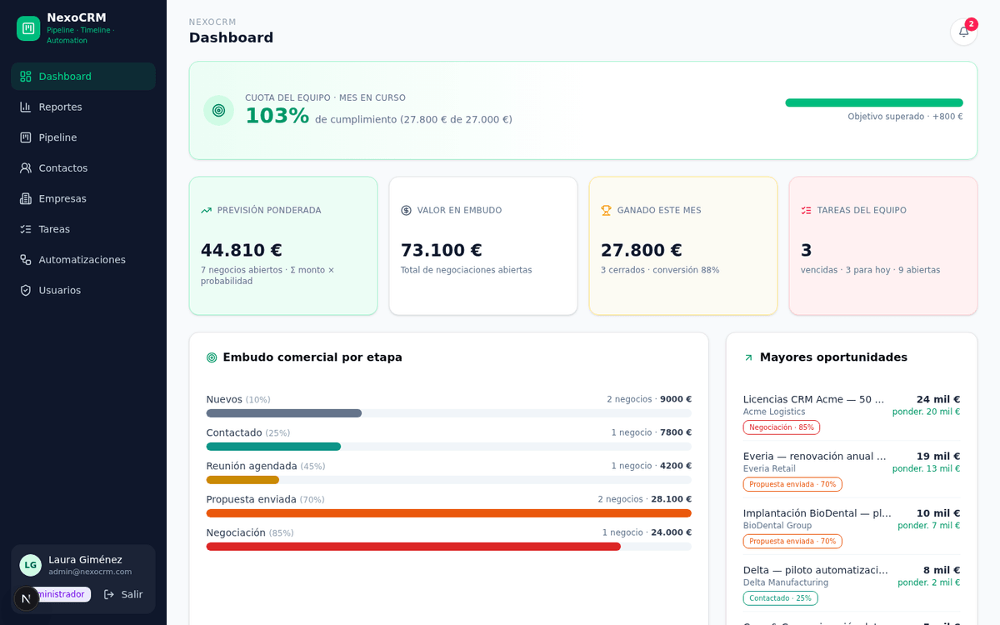
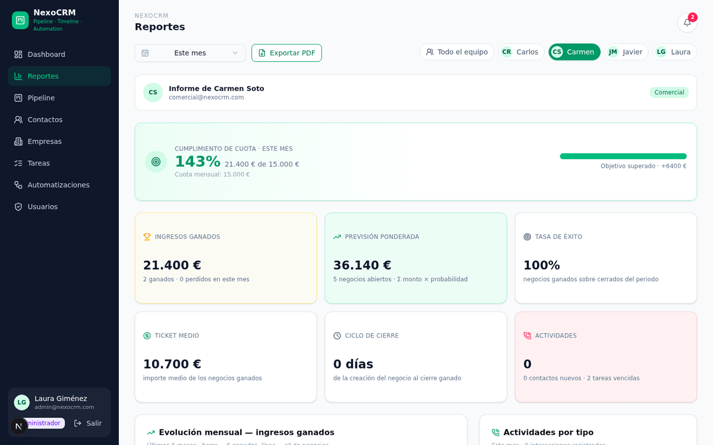
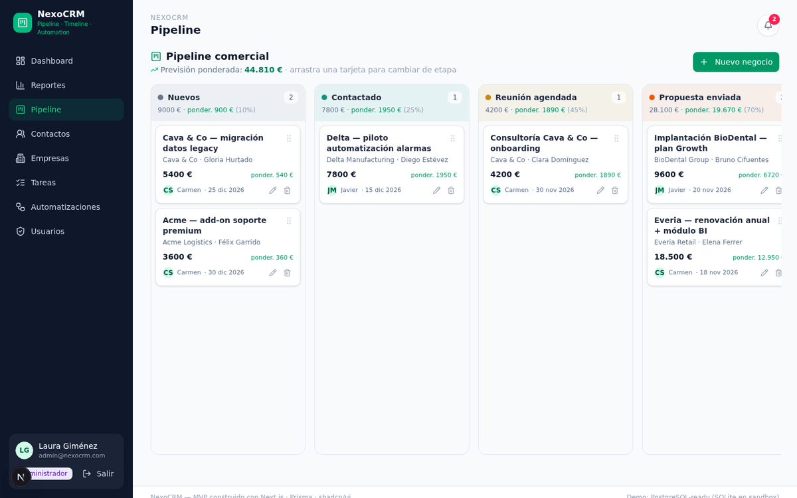
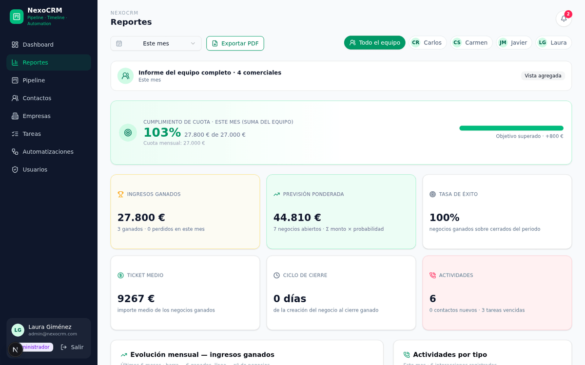
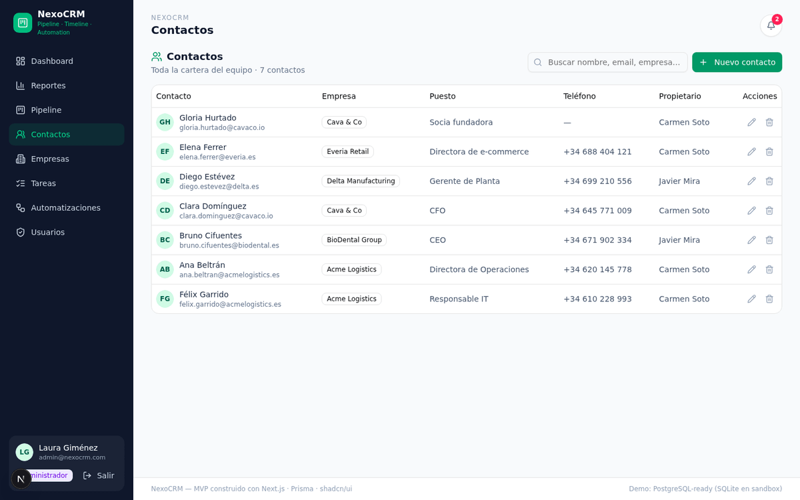
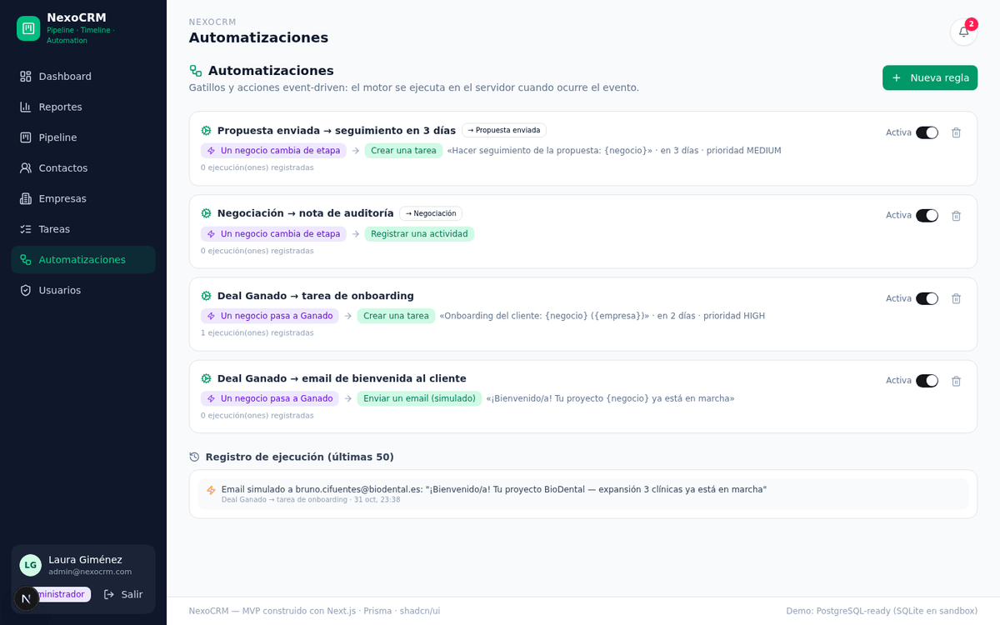

<div align="center">

# 🚀 NexoCRM

**CRM comercial B2B con pipeline Kanban, reportes por comercial y automatizaciones**

[](https://nextjs.org)
[](https://react.dev)
[](https://www.typescriptlang.org)
[](https://www.prisma.io)
[](https://tailwindcss.com)
[](./LICENSE)

</div>

---

## ¿Qué es NexoCRM?

NexoCRM es un sistema de gestión de relaciones con clientes (CRM) orientado a equipos comerciales B2B. Cubre el ciclo completo de venta: **empresas → contactos → negocios → actividades → tareas**, con un pipeline Kanban configurable, previsión de ingresos ponderada por probabilidad, un panel de reportes por comercial con **objetivos (cuotas) y cumplimiento %**, exportación del informe a **PDF**, un motor de **automatizaciones** dirigido por eventos y una **alerta semanal automática** con el ranking del equipo.

Está diseñado con principios MVP: cero fricción de arranque (SQLite + un comando de seed), interfaz en español y roles de acceso claros.

---

## 📸 Capturas de pantalla

| Dashboard | Reporte por comercial |
|---|---|
|  |  |

| Pipeline Kanban | Reportes de equipo |
|---|---|
|  |  |

| Contactos y timeline | Automatizaciones |
|---|---|
|  |  |

> Más vistas en [`docs/screenshots/`](./docs/screenshots): login, tareas y gestión de usuarios con cuotas.

---

## ✨ Funcionalidades

### 📊 Dashboard y reportes
- **Dashboard** con KPIs globales: pipeline abierto, previsión ponderada, negocios ganados/perdidos, actividad reciente y tareas vencidas.
- **Panel de reportes por comercial**: ingresos ganados, tasa de éxito, ticket medio, ciclo medio de cierre, actividades omnicanal por tipo, tareas y evolución mensual (6 meses).
- **Objetivos por comercial (cuota)**: campo `quota` mensual en el usuario, con cálculo automático de **% de cumplimiento** escalado al periodo (mes / trimestre / año).
- **Ranking comparativo del equipo** para dirección, ordenado por ingresos ganados y previsión.
- **Exportación a PDF** del informe completo (jsPDF + autoTable, formato A4 con marca NexoCRM).

### 🎯 Pipeline Kanban
- Tablero de arrastrar y soltar con etapas personalizables (nombre, orden, color, **probabilidad %**).
- **Previsión ponderada** = Σ (monto del negocio × probabilidad de su etapa).
- Marcado de etapas como *Ganado* / *Perdido* que cierra el negocio y registra `closedAt`.

### 👥 Contactos, empresas y tareas
- Fichas de **empresas** (cuentas) y **contactos** con relación normalizada (un contacto → 0..1 empresa; un contacto → 0..N negocios).
- **Timeline omnicanal** por contacto y negocio: llamadas, emails, reuniones, notas y soporte.
- **Tareas** con responsable, prioridad, fecha límite y control de vencidas.

### ⚙️ Automatizaciones
- Motor **dirigido por eventos**: gatillos `DEAL_CREATED`, `DEAL_STAGE_CHANGED`, `DEAL_WON`, `DEAL_LOST` → acciones `CREATE_TASK`, `LOG_ACTIVITY`, `SEND_EMAIL`.
- Reglas activables/desactivables con restricción por etapa destino y **log de auditoría** de cada ejecución.

### 🔔 Alertas y notificaciones
- **Alerta semanal automática con el ranking del equipo**: cada semana ISO se genera una única notificación con el podium de la semana anterior, ingresos cerrados y % de objetivo semanal (cuota mensual prorrateada).
- Cerrojo atómico anti-duplicados (`AlertLog.weekStart` único) + reenvío manual desde dirección.
- Bandeja de notificaciones in-app con marca de leído.

### 🔐 Seguridad y roles (RBAC)
- Autenticación por cookie `httpOnly` firmada con **HMAC-SHA256**, contraseñas con **scrypt + salt**.
- Tres roles jerárquicos: `ADMIN` › `SALES_DIRECTOR` › `SALES_REP`.
- Filtro de cartera por propiedad: un comercial solo ve **sus** datos; dirección y administración lo ven todo.

---

## 🧱 Stack técnico

| Capa | Tecnología | Por qué |
|---|---|---|
| Framework fullstack | **Next.js 16 (App Router)** + React 19 | API routes y UI en un solo despliegue |
| Lenguaje | **TypeScript 5** (estricto) | Tipado end-to-end sin errores de build |
| ORM / BD | **Prisma 6** + SQLite (PostgreSQL-ready) | Cero configuración en local; migración documentada a PostgreSQL |
| UI | **Tailwind CSS 4** + shadcn/ui + Radix | Componentes accesibles y estética profesional |
| Gráficos | **Recharts** | Evolución mensual, embudo y desgloses |
| Kanban | **@dnd-kit** | Drag & drop accesible del pipeline |
| PDF | **jsPDF + jspdf-autotable** | Exportación del informe en el cliente, sin servidor de render |
| Validación | **Zod** | Validación de payloads en la API |

---

## 🚀 Inicio rápido

### Requisitos
- [Bun](https://bun.sh) ≥ 1.1 (o Node.js ≥ 20 + npm/pnpm)
- No requiere base de datos externa: usa SQLite por defecto

### Instalación

```bash
# 1. Clonar
git clone https://github.com/<tu-usuario>/nexocrm.git
cd nexocrm

# 2. Instalar dependencias
bun install        # o: npm install

# 3. Configurar variables de entorno
cp .env.example .env

# 4. Crear el esquema en la base de datos
bunx prisma db push    # o: npm run db:push

# 5. Cargar datos de demostración
bun scripts/seed.ts

# 6. Arrancar en desarrollo
bun run dev            # o: npm run dev
```

Abre **http://localhost:3000** y entra con cualquiera de los usuarios demo.

> 💡 **Producción:** `bun run build` genera un bundle standalone; `bun run start` lo sirve en el puerto 3000.

### 👤 Usuarios de demostración

| Rol | Email | Contraseña | Permisos |
|---|---|---|---|
| Administrador | `admin@nexocrm.com` | `demo1234` | Todo + gestión de usuarios y cuotas |
| Director comercial | `director@nexocrm.com` | `demo1234` | Todo el pipeline y reportes de equipo |
| Comercial | `comercial@nexocrm.com` | `demo1234` | Solo su cartera (cuota 15.000 €/mes) |
| Comercial | `javier@nexocrm.com` | `demo1234` | Solo su cartera (cuota 12.000 €/mes) |

> ⚠️ Cambia estas contraseñas y define `AUTH_SECRET` antes de usar el sistema en producción.

---

## 🔐 Matriz de roles (RBAC)

| Módulo | Comercial | Director comercial | Administrador |
|---|:---:|:---:|:---:|
| Dashboard y pipeline | ✅ solo suyo | ✅ completo | ✅ completo |
| Contactos / Empresas | ✅ solo suyos | ✅ todos | ✅ todos |
| Tareas | ✅ asignadas a él | ✅ todas | ✅ todas |
| Reportes por comercial | ✅ su informe | ✅ cualquiera + equipo | ✅ cualquiera + equipo |
| Cuotas y cumplimiento | 👁️ ve la suya | ✅ define y edita | ✅ define y edita |
| Automatizaciones | ❌ | ✅ | ✅ |
| Usuarios y roles | ❌ | ❌ | ✅ |

---

## 📁 Estructura del proyecto

```
nexocrm/
├── prisma/
│   └── schema.prisma          # Modelo de datos (11 modelos)
├── scripts/
│   └── seed.ts                # Datos demo: equipo, empresas, negocios, actividades
├── src/
│   ├── app/
│   │   ├── api/               # API REST (auth, deals, contacts, companies, tasks,
│   │   │                      #   activities, pipelines, users, automations,
│   │   │                      #   reports, dashboard, alerts)
│   │   ├── layout.tsx
│   │   └── page.tsx           # Shell SPA con navegación por vistas
│   ├── components/
│   │   ├── crm/               # Vistas: Dashboard, Reports, Pipeline, Contacts,
│   │   │                      #   Companies, Tasks, Automations, Users, Login,
│   │   │                      #   NotificationsBell
│   │   └── ui/                # Componentes shadcn/ui
│   ├── hooks/
│   └── lib/
│       ├── auth.ts            # Sesión HMAC + scrypt + RBAC
│       ├── automations.ts     # Motor de reglas (triggers → actions)
│       ├── weekly-alerts.ts   # Alerta semanal de ranking (cron perezoso)
│       ├── report-pdf.ts      # Exportación a PDF del informe
│       ├── client.ts          # Cliente fetch tipado + tipos compartidos
│       └── db.ts              # Instancia única de Prisma
├── docs/                      # 📚 Documentación técnica
├── .env.example
└── package.json
```

---

## 📜 Scripts disponibles

| Comando | Descripción |
|---|---|
| `bun run dev` | Servidor de desarrollo en `:3000` |
| `bun run build` | Build de producción (standalone) |
| `bun run start` | Sirve el build de producción |
| `bun run lint` | ESLint |
| `bun run db:push` | Sincroniza `schema.prisma` con la base de datos |
| `bun run db:generate` | Regenera el cliente Prisma |
| `bun run db:migrate` | Migración en desarrollo |
| `bun scripts/seed.ts` | Recarga los datos de demostración |

---

## 📚 Documentación

La documentación técnica completa está en [`docs/`](./docs):

| Documento | Contenido |
|---|---|
| [Arquitectura](./docs/arquitectura.md) | Capas, decisiones técnicas, seguridad y flujo de sesión |
| [Modelo de datos](./docs/modelo-de-datos.md) | Entidades, relaciones, diagrama ER y migración a PostgreSQL |
| [API REST](./docs/api.md) | Referencia de todos los endpoints con ejemplos |
| [Automatizaciones y alertas](./docs/automatizaciones-y-alertas.md) | Motor de reglas, alerta semanal, cuotas y fórmulas de cumplimiento |
| [Despliegue](./docs/despliegue.md) | Local, Docker/VPS, PostgreSQL, variables de entorno y CI |

---

## 🗺️ Roadmap

- [ ] Envío real de la alerta semanal por email (SMTP/Resend) y Slack
- [ ] Migración oficial a PostgreSQL + Docker Compose listo para producción
- [ ] Importación de contactos desde CSV
- [ ] Campos personalizados por entidad (JSON)
- [ ] Email tracking y plantillas de secuencias
- [ ] i18n completo (es/en) con `next-intl`

---

## 📄 Licencia

Distribuido bajo la [Licencia MIT](./LICENSE).

Las dependencias de terceros y sus licencias están documentadas en [THIRDPARTY-NOTICES.md](./THIRDPARTY-NOTICES.md) (564 paquetes: MIT, ISC, Apache-2.0, BSD…).
