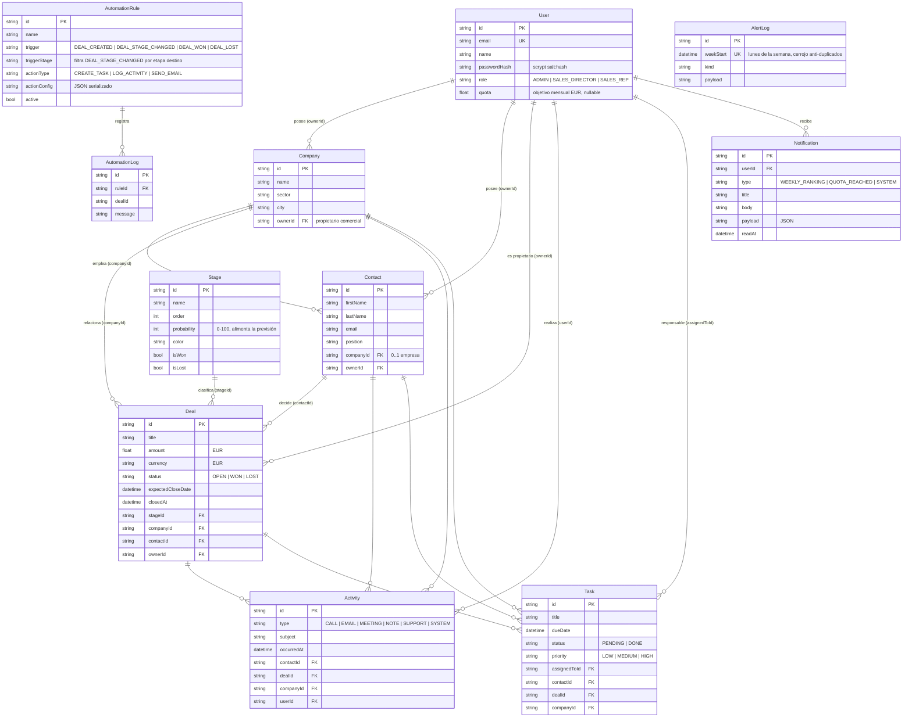

# 🗄️ Modelo de datos

Definición completa en [`prisma/schema.prisma`](../prisma/schema.prisma). El sistema usa **11 modelos** que cubren las cinco entidades núcleo del CRM (empresas, contactos, negocios, actividades, tareas) más la infraestructura de usuarios, embudo, automatizaciones, notificaciones y auditoría.

---

## 1. Diagrama entidad-relación



---

## 2. Reglas de normalización

Las relaciones siguen la regla de oro del modelado CRM:

1. **Un Contacto pertenece opcionalmente a UNA Empresa** (`Contact.companyId` nullable). No hay tabla puente contacto-empresa: en este dominio B2B un contacto trabaja como mucho en una empresa a la vez.
2. **Un Contacto puede estar vinculado a MÚLTIPLES Negocios** (`Deal.contactId`). Un decisor puede participar en varias oportunidades.
3. **Las Actividades se enlazan polimórficamente** a contacto, negocio y/o empresa (`nullable FKs`), formando la cronología omnicanal sin duplicar contenido.
4. **Las Tareas tienen un único responsable** (`assignedToId`) y opcionalmente se anclan a contacto, negocio o empresa.
5. **Toda entidad comercial tiene propietario comercial** (`ownerId` → User): es la clave que sustenta el filtrado RBAC, los reportes por comercial y las cuotas.

### Semántica de borrado (`onDelete`)

| Relación | Al borrar el padre | Justificación |
|---|---|---|
| Contact → Company | `SetNull` | El contacto sobrevive; solo pierde la empresa |
| Deal → Stage/Company/Contact | `SetNull` | El histórico comercial no debe desaparecer |
| Activity/Task → Contact/Deal/Company | `Cascade` | Sin el sujeto, la actividad o tarea huérfana no tiene sentido |
| Todo → User | `SetNull` | Nunca se pierde información comercial al dar de baja a un empleado |
| Notification → User | `Cascade` | Datos personales del usuario eliminado |

---

## 3. Campos de negocio relevantes

### `User.quota` — objetivo mensual por comercial

- Tipo `Float?` en **EUR mensuales**; `null` significa «sin objetivo asignado».
- Es la base del cálculo de **cumplimiento**: ver [automatizaciones-y-alertas.md](./automatizaciones-y-alertas.md#3-cuotas-y-cumplimiento).
- Se escala al periodo de reporte: mes → ×1, trimestre → ×3, año → ×12.
- Para la alerta semanal se prorratea: `objetivo semanal = quota × 7 / días del mes`.

### `Stage.probability` — previsión ponderada

Cada etapa del embudo lleva una probabilidad 0–100. La previsión de ingresos de cualquier agregación es:

```
previsión ponderada = Σ (deal.amount × stage.probability / 100)   [solo deals OPEN]
```

### `Deal.status` vs `Stage.isWon/isLost`

`status` (`OPEN | WON | LOST`) es el estado canónico del negocio. Las banderas `isWon`/`isLost` de la etapa son las que **provocan** la transición al arrastrar el negocio a esa columna en el Kanban, y graban `closedAt`.

---

## 4. Índices y rendimiento

```prisma
// Activity: la cronología se consulta por sujeto + fecha
@@index([contactId, occurredAt])
@@index([dealId, occurredAt])

// Notification: bandeja del usuario + no leídas
@@index([userId, readAt])
@@index([createdAt])

// AutomationLog: histórico cronológico
@@index([createdAt])

// Unicidad funcional
//   User.email            → login
//   AlertLog.weekStart    → cerrojo atómico de la alerta semanal
```

En SQLite no hay `JSON` nativo ni `enum`: se usan `String` (con validación en la API) y JSON serializado. Al migrar a PostgreSQL, conviene convertirlos a `Json` y `enum` reales — ver la guía en [despliegue.md](./despliegue.md#4-migración-de-sqlite-a-postgresql).

---

## 5. Diccionario de estados

| Modelo | Campo | Valores |
|---|---|---|
| User | `role` | `ADMIN` · `SALES_DIRECTOR` · `SALES_REP` |
| Deal | `status` | `OPEN` · `WON` · `LOST` |
| Activity | `type` | `CALL` · `EMAIL` · `MEETING` · `NOTE` · `SUPPORT` · `SYSTEM` |
| Task | `status` | `PENDING` · `DONE` |
| Task | `priority` | `LOW` · `MEDIUM` · `HIGH` |
| AutomationRule | `trigger` | `DEAL_CREATED` · `DEAL_STAGE_CHANGED` · `DEAL_WON` · `DEAL_LOST` |
| AutomationRule | `actionType` | `CREATE_TASK` · `LOG_ACTIVITY` · `SEND_EMAIL` |
| Notification | `type` | `WEEKLY_RANKING` · `QUOTA_REACHED` · `SYSTEM` |
| AlertLog | `kind` | `WEEKLY_RANKING` |
